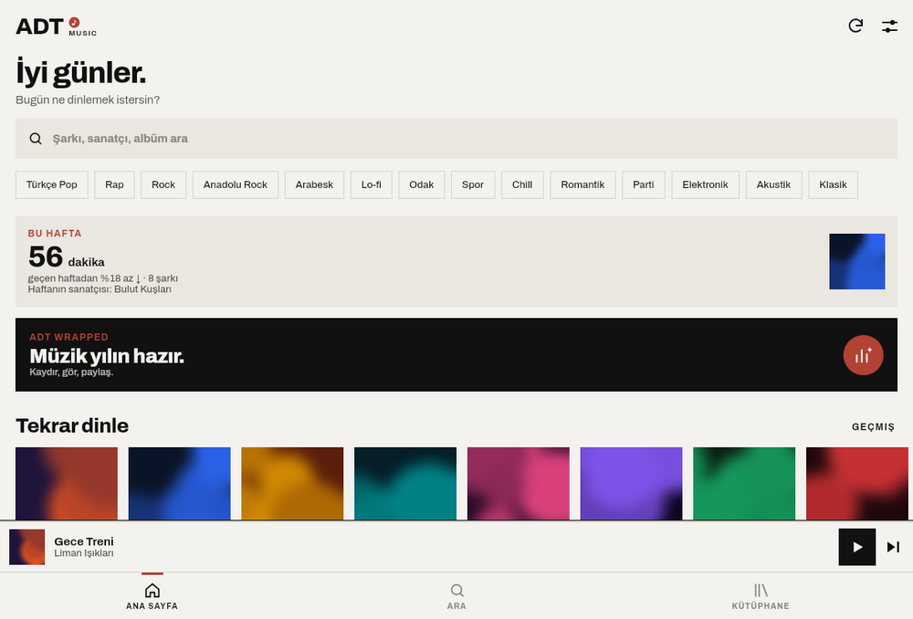
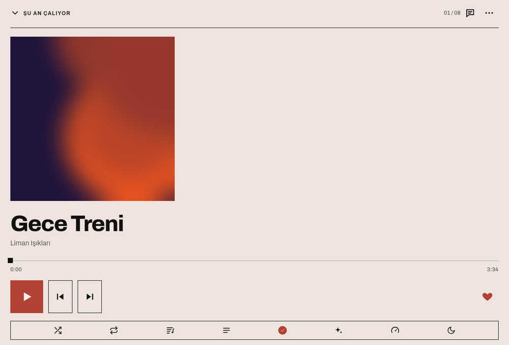
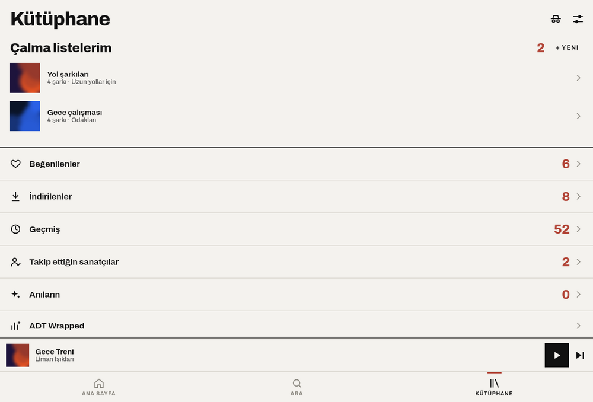
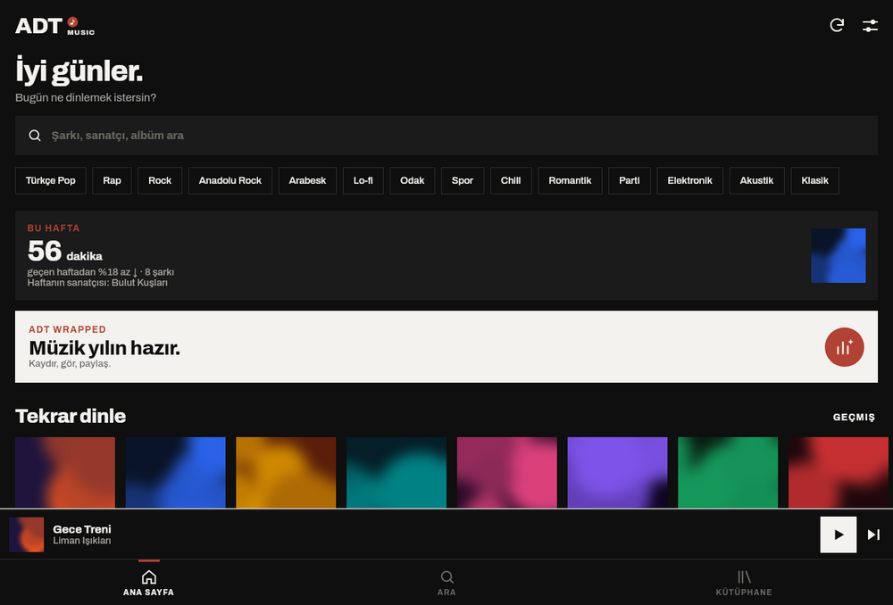

**Reklamsız · Hesapsız · Takipçisiz** YouTube Music istemcisi — Android, Windows ve Linux.

## Ekran görüntüleri

| Ana sayfa | Oynatıcı |
|---|---|
|  |  |
| **Kütüphane** | **Koyu tema** |
|  |  |

Masaüstü sürümünden, örnek verilerle. Android'de arayüz aynıdır.

## İndir

[**Releases**](https://github.com/alideniztartma/adt-music/releases) sayfasından:

| Sistem | Dosya | Not |
|---|---|---|
| Android 8+ | `ADT Music build N` → `.apk` | Güncellemeler uygulamanın içinden gelir |
| Windows 10/11 | `ADT Music masaüstü N` → `.msi` | Kurulumsuz: `windows-portable.zip` |
| Ubuntu / Debian / Mint | `.deb` → `sudo apt install ./adt-music_*.deb` | Ses için: `sudo apt install vlc` |
| Fedora / diğer Linux | `.rpm` ya da `linux-x64.tar.gz` | Ses için VLC gerekir |

## Neler var

- YouTube Music'te şarkı, albüm, sanatçı ve liste arama; trendler, ruh hali sayfaları, otomatik radyo
- Zaman damgalı canlı sözler ve paylaşılabilir söz kartları
- Hız ve ton ayarı, ekolayzer, ses yükseltme, uyku zamanlayıcısı
- İndirme ve internetsiz dinleme, çalma listeleri, beğeniler, geçmiş
- Günlük karışımlar, ADT Wrapped, istatistikler, rozetler, Mixtape
- Şarkıya anı bırakma ve zaman kapsülü
- Kapaktan renk alan tema, koyu mod, köşe ve yazı boyutu seçenekleri
- Yedekleme / geri yükleme — bütün veriler yalnızca senin cihazında

Yalnızca Android'de: bildirim ve kilit ekranı kontrolleri, Android Auto, ses görselleştirici, Bluetooth ile otomatik çalma. 
Masaüstü kısayolları: **Esc** geri · **Ctrl+Boşluk** çal/duraklat · **Ctrl+←/→** önceki/sonraki · medya tuşları.

## Kendin derle

Bilgisayarına bir şey kurman gerekmez; GitHub Actions derler.

1. Depoyu fork'la.
2. **Actions** sekmesinde *APK derle* (Android) ve *Masaüstü derle* (Windows + Linux) işleri kendiliğinden çalışır.
3. Dosyalar **Releases** sayfasına düşer.

Android kodu `app/`, masaüstü kodu `desktop/` klasöründe. Şarkılar açılmazsa genelde çözüm, iki `build.gradle.kts` dosyasındaki `NewPipeExtractor` sürümünü [en yenisiyle](https://github.com/TeamNewPipe/NewPipeExtractor/releases) değiştirmektir.

## Yasal uyarı

Bu proje YouTube veya Google LLC ile ilişkili değildir. Eğitim ve kişisel kullanım amaçlıdır; YouTube verilerine [NewPipeExtractor](https://github.com/TeamNewPipe/NewPipeExtractor) ile erişilir.

## Lisans

[GPL-3.0](LICENSE) · Yazı tipi: Archivo ([OFL](FONT_LICENSE_OFL.txt))
