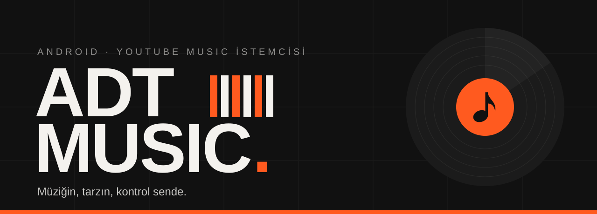
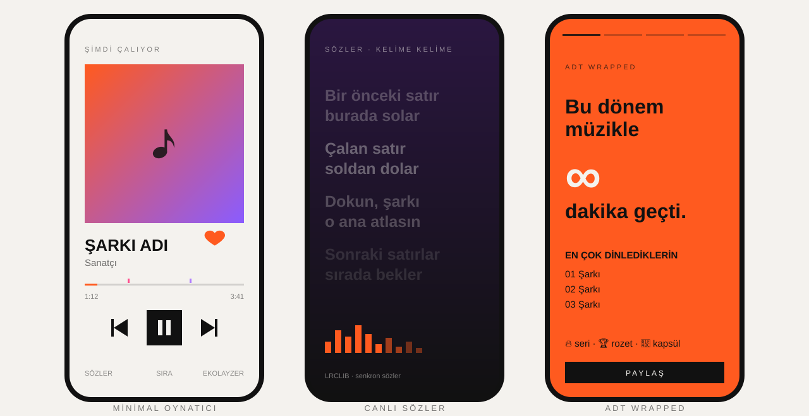
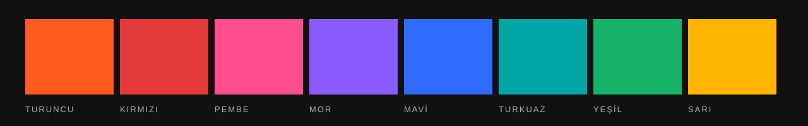
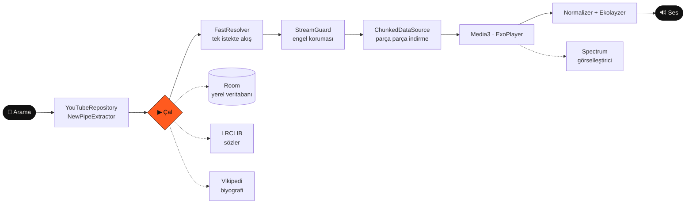

<div align="center">



<br/>

[](https://github.com/alideniztartma/adt-music/releases/latest)
[](#-kurulum)
[](#-kaputun-altı)
[](LICENSE)
[](https://github.com/alideniztartma/adt-music/actions/workflows/build.yml)

### Reklamsız · Hesapsız · Takipçisiz · Tamamen sana ait

YouTube Music'in dev kataloğu, sıfırdan çizilmiş **Minimal** bir tasarım dilinde.<br/>
Kırık beyaz kâğıt, mürekkep siyahı, keskin köşeler, büyük başlıklar — ve çalan şarkının kapağından gelen **tek bir vurgu rengi**.

[**⬇ APK'yı indir**](https://github.com/alideniztartma/adt-music/releases/latest) &nbsp;·&nbsp;
[Özellikler](#-özellikler) &nbsp;·&nbsp;
[Kişiselleştirme](#-kişiselleştirme) &nbsp;·&nbsp;
[Kaputun altı](#-kaputun-altı) &nbsp;·&nbsp;
[Derleme](#-kurulum)

<br/>



<sub>Temsili çizim — uygulamanın tasarım dilini gösterir.</sub>

</div>

<br/>

## ◼ Neden ADT Music?

<table>
<tr>
<td width="25%" valign="top">

### 🚫 Reklam yok
Ne şarkı arasında, ne açılışta. Sadece müzik.

</td>
<td width="25%" valign="top">

### 🔒 Gizli
Hesap yok, telemetri yok. Beğeniler, listeler ve geçmiş **yalnızca cihazında**.

</td>
<td width="25%" valign="top">

### ✏️ Özgün tasarım
Tek bir Material bileşeni yok. Her düğme, her ekran sıfırdan çizildi.

</td>
<td width="25%" valign="top">

### ⚡ Hızlı
Tek istekte akış çözümü, parça parça indirme, sıradaki şarkıyı önceden yükleme.

</td>
</tr>
</table>

<br/>

## ◼ Özellikler

<table>
<tr>
<td width="50%" valign="top">

#### 🔎 Keşif
- Şarkı, albüm, sanatçı, liste ve video arama — öneriler, sonsuz kaydırma, *"bunu mu demek istedin?"*
- Ana sayfa: **Senin için**, Türkiye trendleri, öne çıkan listeler, tekrar dinle, **Takip ettiklerinden**
- 14 ruh hali / tür sayfası — Türkçe Pop, Rap, Anadolu Rock, Lo-fi, Odak…
- Sanatçı ve albümler için **Vikipedi biyografileri** (önce Türkçe)
- YouTube bağlantısını paylaş ya da *"ADT Music ile aç"* → anında çalar

</td>
<td width="50%" valign="top">

#### ▶️ Dinleme
- Arka planda çalma; bildirim, kilit ekranı, kulaklık ve Bluetooth kontrolleri
- **Otomatik radyo** — sıra bitince benzer şarkılarla devam
- Sıra yönetimi, karıştır, tekrarla, kaldığın yerden devam
- **Hız ve ton** (0.5x – 2x, ±12 yarım ton) · *Slowed, Daycore, Nightcore*
- Şarkılar arası geçiş (crossfade), sessiz kısımları atlama
- 🚗 **Android Auto** desteği, sesli arama dahil

</td>
</tr>
<tr>
<td valign="top">

#### 🎤 Canlı sözler
- LRCLIB'den **zaman damgalı** sözler
- Çalan satır soldan sağa dolar, kendiliğinden kayar
- Satıra dokun → şarkı o ana atlar
- Kelime kelime, dolgu, parlama ve daha fazla animasyon
- **Söz kartı**: sevdiğin dizeyi görsel olarak paylaş

</td>
<td valign="top">

#### 🎚️ Ses
- 10 ön ayarlı **ekolayzer** + bant bant ayar
- Bas güçlendirme, sanal surround, ses yükseltme
- **Ses dengeleme** — şarkılar arası seviye farkını yumuşakça eşitler
- Canlı **ses görselleştirici** (16 bant, yalnızca ekrandayken çalışır)
- Uyku zamanlayıcısı — sesi kısarak durdurur, *"şarkı bitince"* seçeneği

</td>
</tr>
<tr>
<td valign="top">

#### 🧠 Karışımlar & akıllı listeler
| | |
|---|---|
| 🟧 **Günlük Karışım** | her gün yenilenir |
| 🟦 **Keşif Karışımı** | hiç dinlemediğin ama seveceklerin |
| 🟪 **Geçmişe Yolculuk** | çok dinleyip unuttukların |
| 🩷 **Beğeni Radyosu** | beğendiklerinden yola çıkar |

Ve cihazda kendiliğinden güncellenen 6 akıllı liste: *En çok dinlediğim 50, Gece şarkılarım, Unutulmuş beğeniler…*

</td>
<td valign="top">

#### ✦ Anılar & zaman kapsülü
- Şarkının bir saniyesine **anı** bırak: Mutlu, Hüzünlü, Nostaljik, Enerjik, Huzurlu, Âşık
- Anılar ilerleme çubuğunda küçük renkli işaretler olarak görünür
- **Anı haritası** — hangi şarkı hayatının hangi döneminde yanındaydı
- 💌 **Zaman kapsülü** — bir anıyı mühürle, ileri bir tarihte açılsın

</td>
</tr>
<tr>
<td valign="top">

#### 📊 Wrapped & istatistikler
- **ADT Wrapped** — dönemlik dinleme özeti, kaydırmalı hikâye sayfaları, paylaşılabilir kartlar
- 🔥 Dinleme serisi, *"Bu hafta"* özeti
- Toplam süre, en çok dinlenen şarkı ve sanatçılar
- 📼 **Mixtape** — arkadaşınla QR kodla zevk karşılaştır: *"Aynı kasette iyi çalarsınız"*

</td>
<td valign="top">

#### 📥 Çevrimdışı & kütüphane
- Şarkı, albüm, liste ya da tüm beğenilenleri indir
- **Akıllı önbellek** (512 MB – 4 GB) — yer dolunca en eskisi silinir
- Çalma listeleri, **kapak oluşturucu**, açıklama düzenleme
- Gün gün dinleme geçmişi, sanatçı takibi
- Kütüphaneyi tek JSON dosyasına **yedekle / geri yükle**

</td>
</tr>
<tr>
<td valign="top">

#### 💬 Şarkının etrafında
- **YouTube yorumları** — sabitlenen, sanatçının beğendiği ve yanıtlar
- Yorumdaki `1:24` gibi zaman damgasına dokun → o ana atla
- *Şarkı hakkında* sayfası

</td>
<td valign="top">

#### 🔔 Arka planda akıllı
- Takip ettiğin sanatçının **yeni şarkısı** çıkınca bildirim
- Pazar akşamları **haftalık özet**
- Bluetooth bağlanınca kaldığı yerden **otomatik çalma**
- **Uygulama içi güncelleme** — yeni sürümü GitHub'dan indirip kurar
- Aylık **veri kullanımı** (mobil / Wi-Fi ayrı)

</td>
</tr>
</table>

<br/>

## ◼ Rozetler

Dinledikçe açılır. Hepsi cihazda hesaplanır.

<div align="center">

| ♪ İlk Adım | 🔎 Meraklı | 🧭 Kâşif | 🌍 Geniş Ufuk | 🌙 Gece Kuşu | 🌅 Erken Kalkan |
|:-:|:-:|:-:|:-:|:-:|:-:|
| **⏱ Maratoncu** | **🏆 Efsane** | **🔁 Sadık** | **♥ Koleksiyoncu** | **📋 Liste Ustası** | **⭐ Hayran** |
| **✦ Anı Avcısı** | **💌 Zaman Yolcusu** | **⬇ Çevrimdışı** | **📅 Bir Hafta** | **🗓 Alışkanlık** | **💯 Durdurulamaz** |

</div>

<br/>

## ◼ Kişiselleştirme



Vurgu rengi çalan şarkının kapağından çıkarılır ve akıcı bir geçişle değişir — ya da sabit bir renk seçersin. **Uygulama simgesi bile seçtiğin renge bürünür.**

<table>
<tr>
<td width="50%" valign="top">

**Oynatıcı**
- İki oynatıcı stili: **Minimal** ve kapak renklerinden dalgalanan zeminli **Apple Music tarzı**
- Kapak boyutu, kapak animasyonu (nefes alma), oynatıcı arka planı
- Kapağı kaydırarak şarkı değiştir, çift dokunarak beğen
- Oynatıcıyı aşağı çekerek küçült, mini oynatıcıyı kaydırarak kapat

</td>
<td width="50%" valign="top">

**Arayüz**
- Açık / koyu / sistem · **AMOLED siyah**
- Köşe stili, yazı boyutu, açılış sayfası, ana sayfa rafları
- Söz animasyonu, hizası, kalınlığı, aralığı, bulanıklığı
- **120 Hz** akıcılık, hareketleri azaltma, titreşim
- Başlatıcı kısayolları: *Ara · Beğenilenleri karıştır · Günlük Karışım*

</td>
</tr>
</table>

<br/>

## ◼ Kaputun altı



<table>
<tr>
<td align="center" width="25%"><h3>~4×</h3><sub>daha az YouTube isteği<br/>(tek oynatıcı isteği, 12 saat aynı oturum)</sub></td>
<td align="center" width="25%"><h3>1→3→8→15 dk</h3><sub>engel görülünce artan aralıklarla<br/>geri çekilme ve yeni oturum</sub></td>
<td align="center" width="25%"><h3>0</h3><sub>Material bileşeni —<br/>hepsi özel çizim</sub></td>
<td align="center" width="25%"><h3>~14.500</h3><sub>satır Kotlin</sub></td>
</tr>
</table>

**Teknolojiler:** Kotlin · Jetpack Compose · Media3 / ExoPlayer · Room · Coil · Palette · NewPipeExtractor · LRCLIB · OkHttp · WorkManager · ZXing

```
app/src/main/java/com/alideniz/adtmusic/
├── data/        YouTube Music, akış çözücü, sözler, Vikipedi, karışımlar, istatistikler, yedek, güncelleme
├── playback/    çalma servisi, önbellek, indirmeler, ekolayzer, ses dengeleme, görselleştirici, arka plan işleri
└── ui/          tema, simgeler, bileşenler, ekranlar (oynatıcılar, Wrapped, anılar, ayarlar…)
```

<br/>

## ◼ Kurulum

### 📱 Hazır APK

1. [**Releases**](https://github.com/alideniztartma/adt-music/releases/latest) sayfasından son `ADT Music build N` APK'sını indir.
2. Telefonda aç, *"bilinmeyen kaynaklara izin ver"* de, kur.
3. Sonraki güncellemeler uygulamanın içinden gelir.

### 🛠️ Kendin derle

Bilgisayara hiçbir şey kurman gerekmez — APK'yı GitHub derler.

1. Depoyu fork'la ya da tüm dosyaları (gizli `.github` klasörü dahil) kendi depona yükle.
2. **Actions** sekmesinde *"APK derle"* işi kendiliğinden başlar (~8–12 dk).
3. APK iki yerde hazır olur: **Releases** → `ADT Music build N` ve işin sayfasında **Artifacts → ADT-Music-apk**.

> [!TIP]
> Derleme hata verirse Actions sayfasındaki kırmızı adımı aç, hata satırlarını kopyalayıp Claude'a gönder.

<details>
<summary><b>🔑 İmza anahtarı</b></summary>
<br/>

`app/adtmusic.jks`, güncellemelerin eskisinin üstüne kurulabilmesi için depoda duran sabit bir anahtardır. Uygulamayı başkalarıyla paylaşacaksan kendi anahtarını oluştur ve GitHub Secrets ile ver:

`ADT_KEYSTORE_PATH` · `ADT_KEYSTORE_PASSWORD` · `ADT_KEY_ALIAS` · `ADT_KEY_PASSWORD`

</details>

<details>
<summary><b>🔧 YouTube değişince şarkılar açılmazsa</b></summary>
<br/>

YouTube sayfa yapısını zaman zaman değiştirir. Çözüm genelde NewPipeExtractor'ı güncellemektir: `app/build.gradle.kts` içindeki `NewPipeExtractor:v0.27.1` satırını [en yeni sürümle](https://github.com/TeamNewPipe/NewPipeExtractor/releases) değiştir (gerekirse uyumlu `nanojson` sürümünü de) ve tekrar derle.

</details>

<br/>

## ◼ Yasal uyarı

> [!WARNING]
> Bu proje YouTube, Google LLC veya bağlı kuruluşlarıyla ilişkili değildir ve onlar tarafından onaylanmamıştır. Resmî bir API kullanmaz; eğitim ve kişisel kullanım amacıyla geliştirilmiştir. YouTube'un kullanım şartlarına aykırı olabileceğinden Play Store'da yayınlanması uygun değildir.

## ◼ Lisans

**GPL-3.0** (NewPipeExtractor GPL-3.0 lisanslı olduğu için). Archivo yazı tipi SIL Open Font License ile dağıtılır ([`FONT_LICENSE_OFL.txt`](FONT_LICENSE_OFL.txt)).

<br/>

<div align="center">


<sub>**Ali Deniz** tarafından, müzik dinleyerek yapıldı. ♪</sub>

</div>
